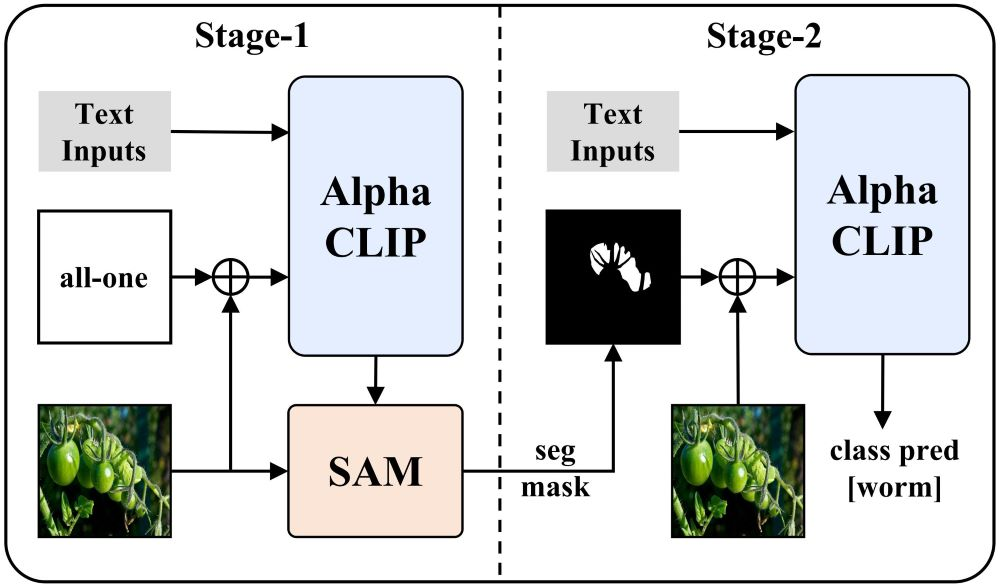
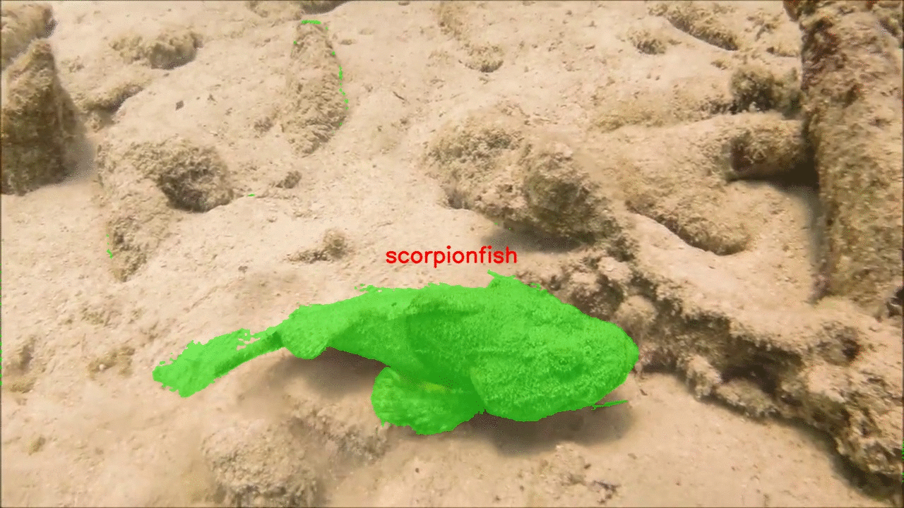

# Open-Vocabulary Camouflaged Object Segmentation with Cascaded Vision-Language Models

[](https://arxiv.org/abs/2506.19300)

---

## 📌 Overview

<div align="center">
  
</div>

This repository provides the official implementation of our paper:  
**"Open-Vocabulary Camouflaged Object Segmentation with Cascaded Vision-Language Models"**,  
which introduces a cascaded two-stage framework for segmenting and recognizing camouflaged objects in open-vocabulary settings.

---

## 📁 Setup

### 🔹 Dataset

1. Download the **OVCamo** dataset from the [official repository](https://github.com/lartpang/OVCamo).
2. Update the dataset path in the following config file:

`./datasets/ovcamo_info/splitted_ovcamo.yaml`

### 🔹 Pretrained Model

Download the SAM backbone from Meta AI:

- [sam_vit_h_4b8939.pth](https://dl.fbaipublicfiles.com/segment_anything/sam_vit_h_4b8939.pth)

Place the file in the `./pretrained` directory:

`./pretrained/sam_vit_h_4b8939.pth`

---

## 🚀 Demo

<div align="center">
  
</div>

Download our best pre-trained model:

- [model_epoch_best.pth](https://pan.baidu.com/s/1S6rWjBe-MNkV64t83nXKDQ?pwd=3zdc)
- [model-best.pth.tar](https://pan.baidu.com/s/1y899cq2bmRhAZO2KL1IVVg?pwd=pw6q)
- 
Save it to:

`./best_model_pth/model_epoch_best.pth`

Run the demo with:

```bash
python demo.py \
  --img-path ./demo_img/scorpionfish.jpg \
  --output-dir ./demo_img \
  --config ./configs/demo.yaml \
  --model ./best_model_pth/model_epoch_best.pth
